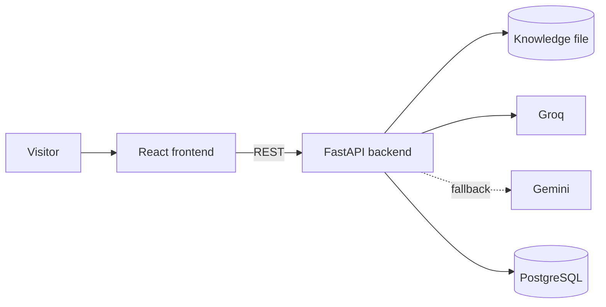

# Johan Rendon | Portfolio with AI assistant

Personal portfolio of **Johan Alexis Rendon Granada**, Junior Backend Developer (Python, FastAPI) with React experience. It includes an AI assistant that answers recruiters' questions about Johan's experience, projects and availability, using a curated knowledge file as its only source of truth.

[](https://github.com/Joalregra/developer-portfolio/actions/workflows/ci.yml)

> 🚧 **Status:** in active development. The live site and screenshots will be added at launch.

## Features
- Bilingual single-page portfolio (Spanish and English), prerendered at `/es/` and `/en/`
- Downloadable CV
- AI assistant with quick-question buttons, grounded only on [`backend/knowledge/ChatbotKnowledge.en.md`](backend/knowledge/ChatbotKnowledge.en.md)
- Layered defence against prompt injection, and a set of attacks to measure it ([`backend/evals/`](backend/evals/README.md))
- LLM provider failover (Groq → Gemini) and per-visitor rate limiting
- Visitors can rate each answer as helpful or not; the log is anonymous and deleted after 90 days

## Stack
| Layer | Technologies |
|---|---|
| Frontend | React 19, TypeScript, Vite, Tailwind CSS, Vitest, React Testing Library |
| Backend | Python 3.12, FastAPI, SQLAlchemy 2, Alembic, Pydantic Settings, pytest, Ruff, mypy |
| Data | PostgreSQL (Neon) |
| AI | Groq (primary), Gemini (fallback) |
| Infrastructure | Docker, Caddy, GitHub Actions, Cloudflare Pages |

## Architecture

More detail in [docs/architecture.md](docs/architecture.md) and the reasoning behind each choice in [docs/decisions.md](docs/decisions.md).

## Run locally

**Requirements:** Node 20+, Python 3.12+ and optionally Docker.

```bash
git clone https://github.com/Joalregra/developer-portfolio.git
cd developer-portfolio

# Backend
cd backend
python -m venv .venv && source .venv/bin/activate   # Windows: .venv\Scripts\activate
pip install -r requirements-dev.txt
cp .env.example .env
uvicorn app.main:app --reload                        # http://localhost:8000/docs

# Frontend (second terminal)
cd frontend
npm install
cp .env.example .env
npm run dev                                          # http://localhost:5173/es/ and /en/
```

With Docker, `docker compose up` starts PostgreSQL and the backend (it needs `backend/.env`). The frontend is not in the compose file.

### Frontend variables
| Variable | Description |
|---|---|
| `VITE_API_URL` | Backend base URL. Public: it ships in the bundle, so never put a secret in a `VITE_` variable |
| `VITE_SITE_URL` | Public origin of the site, without a trailing slash. Drives canonical tags, Open Graph URLs and `sitemap.xml`; leave it empty in development |

## Backend

### How the chat works
`POST /api/chat` answers questions about Johan and nothing else. A question goes through, in order: the on/off switch, the per-visitor rate limit, the quick-question shortcut (a button is answered from the knowledge file with no model), text cleaning that masks emails and phone numbers, a list of known attack phrases, the answer cache (a repeated question is served from memory with no model), the Prompt Guard 2 classifier, the daily budget, the model, and an output validator that replaces a leaked prompt, a link to another site or an off-topic answer with a fixed refusal. The model is Groq `gpt-oss-120b`; if Groq is rate limited or down, the router tries Gemini (only for visitors outside the EU, EEA, UK and Switzerland). The answer is sent first and the anonymous log row is written afterwards, so the assistant never depends on the database.

Every step, every failure and what each one logs is in [docs/chat-flow.md](docs/chat-flow.md). The request and response bodies and the error codes are in [docs/architecture.md](docs/architecture.md); `/docs` (Swagger UI) shows them live.

| Endpoint | What it does |
|---|---|
| `GET /health` | The process is alive and the knowledge file is loaded (with its version). It calls no provider |
| `POST /api/chat` | Answers one question. A refusal is still `200` with `refused: true` |
| `POST /api/chat/feedback` | Rates an answer as helpful or not. One rating per answer; repeating it answers `204` and changes nothing. `404` if the answer was never stored |

Every error has the same body, `{"error": {"code", "message", "request_id", "details"}}`, and clients branch on `code`.

### Environment variables
Copy `backend/.env.example` to `backend/.env`; nothing from it is committed. Every secret is a `SecretStr` and never appears in a log.

| Variable | Needed | Description |
|---|---|---|
| `ENVIRONMENT` | | `development`, `test` or `production`. Production refuses a `CORS_ORIGINS` that is not explicit `https` |
| `LOG_LEVEL` | | `DEBUG`, `INFO` (default), `WARNING` or `ERROR`. Logs are JSON, one line per request, never with the visitor's question |
| `CORS_ORIGINS` | production | JSON list of the frontend origins allowed, for example `["https://johan.example"]` |
| `MAX_BODY_BYTES` | | Bigger request bodies are rejected with `413` (default 16384) |
| `GROQ_API_KEY`, `GROQ_MODEL` | yes | Primary provider. Model names are settings because free tiers change often |
| `GUARD_MODEL` | yes | Prompt Guard 2 model, called through the same Groq account |
| `CANARY_TOKEN` | yes | Random string placed in the system prompt to detect a leak. Keep it stable: `python -c "import secrets; print('CANARY-' + secrets.token_hex(8))"` |
| `GEMINI_API_KEY`, `GEMINI_MODEL` | optional | First fallback. Never used for the EU, EEA, UK, Switzerland or an unknown country |
| `TRUST_CLOUDFLARE_HEADERS` | | `true` only when the API is really behind Cloudflare: the visitor's country comes from `CF-IPCountry`. With `false` (default) the country is unknown and Gemini is never used |
| `SITE_URL` | | Public address of the portfolio. Answers may link to it; every other link is removed |
| `CHAT_ENABLED` | | `false` is the kill switch: the chat answers `503 assistant_paused` |
| `RATE_LIMIT_PER_MINUTE`, `RATE_LIMIT_PER_DAY` | | Per visitor (an IPv4 address or an IPv6 /56 block). Defaults 10 and 30 |
| `DAILY_LLM_BUDGET` | | Model calls a day before the assistant pauses (default 300) |
| `ANSWER_CACHE_TTL_SECONDS`, `ANSWER_CACHE_MAX_ENTRIES` | | A repeated question (same language, no history) is answered from memory without a model call, for this many seconds and up to this many entries. Defaults 86400 and 500; `0` seconds switches it off |
| `GUARD_TIMEOUT_SECONDS`, `GROQ_TIMEOUT_SECONDS`, `GEMINI_TIMEOUT_SECONDS`, `REQUEST_TIMEOUT_SECONDS` | | Time limits for every external call and for the whole request (defaults 3, 12, 15 and 25 seconds) |
| `DATABASE_URL` | recommended | The app user (`portfolio_app`), which can only `INSERT` and `SELECT`. Without it the chat works but logs nothing |
| `MIGRATION_DATABASE_URL` | to migrate | The owner, used only by Alembic. Falls back to `DATABASE_URL` |
| `RETENTION_DATABASE_URL` | for the job | The user `portfolio_retention` (`SELECT` and `DELETE`). Only the retention job reads it |
| `CHAT_LOG_RETENTION_DAYS` | | How long a message is kept (default 90) |
| `FORWARDED_ALLOW_IPS` | production | Read by uvicorn, not by the app: the address of the proxy (Caddy), so the real visitor IP is used for the rate limit |

The chat does not start if a required setting is missing, and says which one.

### Database
PostgreSQL holds two tables: the anonymous log of questions (`chat_messages`) and the ratings (`feedback`). No IP, user agent or other identifier is stored. The tables are created once by hand, then tracked by Alembic:

```bash
psql "$OWNER_DATABASE_URL" -v ON_ERROR_STOP=1 -f backend/sql/schema.sql
psql "$OWNER_DATABASE_URL" -v ON_ERROR_STOP=1 -v app_password='<long random>' -f backend/sql/roles.sql
psql "$OWNER_DATABASE_URL" -v ON_ERROR_STOP=1 -v retention_password='<long random>' -f backend/sql/retention_role.sql
cd backend && alembic stamp head
```

`schema.sql` always describes the latest schema, so a new database is only stamped; later changes are Alembic migrations. On an empty local database (`docker compose up db -d`) skip the SQL files and run `alembic upgrade head` as the owner. `alembic upgrade head --sql` prints the DDL without a database. A test fails if the ORM models and `schema.sql` differ, so change both together.

### Retention
Rows older than `CHAT_LOG_RETENTION_DAYS` (90) are deleted, with their ratings, by a command that cron runs once a day on the server:

```bash
python -m app.jobs.purge_chat_log        # exit code 0 on success, 1 on any failure
```

```cron
15 3 * * *  cd /srv/portfolio && docker compose run --rm backend python -m app.jobs.purge_chat_log
```

It connects with `RETENTION_DATABASE_URL` (the `portfolio_retention` user), deletes in batches of 1,000 and logs how many rows it removed. The compose line is the plan for the VM and is installed with the deployment files.

### Evaluation of the assistant
`backend/evals/` has 33 attacks and 31 recruiter questions, in Spanish and English, and a runner you launch by hand against the real models (it is not in the CI because it spends free-tier quota):

```bash
cd backend
python -m evals.run_evals                  # or --only attacks, --ids A01,L05, --resume <report>
```

It measures what can be observed (the canary or a foreign link in an answer, an attack that was answered, a legitimate question that was refused) and saves a report with the date and the models in `backend/evals/results/`. See [backend/evals/README.md](backend/evals/README.md).

## Tests and quality
```bash
cd frontend && npm run format:check && npm run lint && npm test && npm run build
cd frontend && npm run test:layout && npm run lighthouse   # on the build; need a browser, see frontend/README.md
cd backend && ruff check . && ruff format --check . && mypy app tests evals && pytest
```
GitHub Actions runs the same on every push to `main` and on every pull request, plus the layout checks and Lighthouse on the production build.

## Roadmap
- [x] Project structure, CI and base configuration
- [x] Portfolio sections (about, experience, projects, skills, contact) in ES/EN, prerendered
- [x] Chat endpoint with Groq/Gemini failover, defences against prompt injection and rate limiting
- [x] Chat widget with quick questions and answer ratings
- [x] Anonymous log in PostgreSQL with 90-day retention
- [x] Evaluation set for the assistant
- [ ] Deployment with custom domain (production compose file, Caddy, cron for the retention job)
- [x] Demo of the Gedocs project with test data

## Author
**Johan Alexis Rendon Granada** · [LinkedIn](https://www.linkedin.com/in/johan-rendon-granada-14b8a82bb) · [GitHub](https://github.com/Joalregra) · johanalexis808@gmail.com

## License
[MIT](LICENSE)
