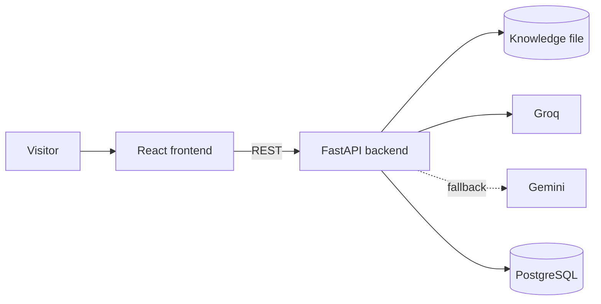

# Johan Rendon | Portfolio with AI assistant

Personal portfolio of **Johan Alexis Rendon Granada**, Junior Backend Developer (Python, FastAPI) with React experience. It includes an AI assistant that answers recruiters' questions about Johan's experience, projects and availability, using a curated knowledge file as its only source of truth.

[](https://github.com/Joalregra/portfolio/actions/workflows/ci.yml)

> 🚧 **Status:** in active development. The live site and screenshots will be added at launch.

## Features
- Bilingual single-page portfolio (Spanish and English)
- Downloadable CV
- AI assistant with quick-question buttons, grounded only on [`backend/knowledge/ChatbotKnowledge.en.md`](backend/knowledge/ChatbotKnowledge.en.md)
- LLM provider failover (Groq → Gemini) and per-IP rate limiting

## Stack
| Layer | Technologies |
|---|---|
| Frontend | React 19, TypeScript, Vite, Tailwind CSS, Vitest, React Testing Library |
| Backend | Python 3.12, FastAPI, Pydantic Settings, pytest, Ruff |
| Data | PostgreSQL (Neon) |
| AI | Groq (primary), Gemini (fallback) |
| Infrastructure | Docker, Caddy, GitHub Actions, Cloudflare Pages |

## Architecture

More detail in [docs/architecture.md](docs/architecture.md) and the reasoning behind each choice in [docs/decisions.md](docs/decisions.md).

## Run locally

**Requirements:** Node 20+, Python 3.12+ and optionally Docker.

```bash
git clone https://github.com/Joalregra/portfolio.git
cd portfolio

# Backend
cd backend
python -m venv .venv && source .venv/bin/activate   # Windows: .venv\Scripts\activate
pip install -r requirements-dev.txt
cp .env.example .env
uvicorn app.main:app --reload                        # http://localhost:8000/docs

# Frontend (second terminal)
cd frontend
npm install
cp .env.example .env
npm run dev                                          # http://localhost:5173
```

With Docker, `docker compose up` starts PostgreSQL and the backend.

### Environment variables
| Variable | Where | Description |
|---|---|---|
| `VITE_API_URL` | frontend | Backend base URL |
| `CORS_ORIGINS` | backend | Allowed frontend origins (JSON list) |
| `GROQ_API_KEY` | backend | Primary LLM provider key |
| `GEMINI_API_KEY` | backend | Fallback LLM provider key |
| `DATABASE_URL` | backend | PostgreSQL connection string |

## Tests and quality
```bash
cd frontend && npm run lint && npm test
cd backend && ruff check . && pytest
```
GitHub Actions runs formatting, linting, tests and the production build on every push and pull request.

## Roadmap
- [x] Project structure, CI and base configuration
- [ ] Portfolio sections (about, experience, projects, skills, contact) in ES/EN
- [ ] Chat endpoint with Groq/Gemini failover and rate limiting
- [ ] Chat widget with quick questions
- [ ] Deployment with custom domain
- [ ] Demo of the Gedocs project with test data

## Author
**Johan Alexis Rendon Granada** · [LinkedIn](https://www.linkedin.com/in/johan-rendon-granada-14b8a82bb) · [GitHub](https://github.com/Joalregra) · johanalexis808@gmail.com

## License
[MIT](LICENSE)
