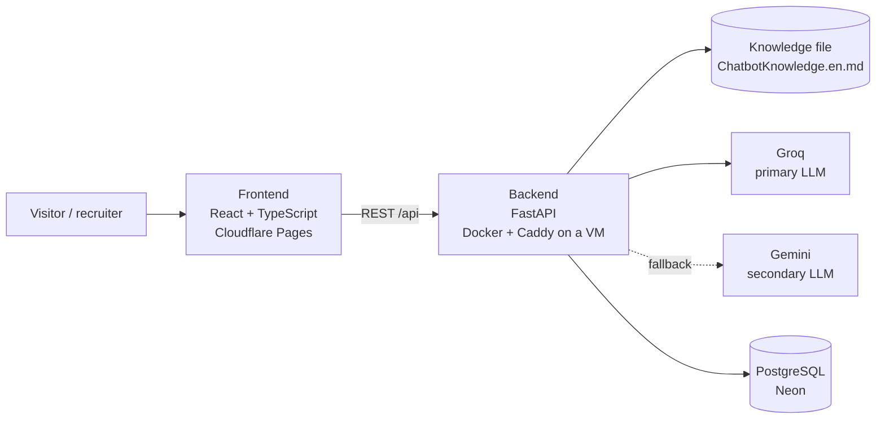

# Architecture



| Part | Responsibility |
|---|---|
| Frontend | Static single-page portfolio (ES/EN), CV download and the chat widget. Talks to the backend only through `src/services/api.ts`. |
| Backend | Validates chat requests, builds the system prompt from the knowledge file, calls the LLM provider with failover, enforces rate limits and stores anonymous chat logs. |
| Knowledge file | Single source of truth about Johan for the assistant. Versioned with the code. |
| PostgreSQL | Anonymous log of questions asked to the assistant (no personal data), used to improve the knowledge file. |

## Chat contract (frontend ready, backend pending)

The chat UI is implemented and talks to a `POST /chat` endpoint that does not exist yet. Until it does, the panel shows the "assistant unavailable" state with the contact email. Types live in `frontend/src/services/api.ts`.

```jsonc
// POST /chat
{ "message": "string, 1 to 1000 characters",
  "locale": "es" | "en",                      // language of the site UI, the answer follows the question
  "history": [{ "role": "user" | "assistant", "content": "string" }] }   // last 10 turns

// 200
{ "answer": "plain text",
  "sources": ["projects" | "experience" | "about" | "skills" | "education" | "contact"] }  // optional

// 429 rate limit per IP, 503 LLM unavailable: the UI has a message for each
```

`sources` is optional: when present, the UI links each section under the answer ("Ver en: Proyectos").

## Frontend build

`npm run build` type-checks, builds the client, builds a server bundle of the app and prerenders `/es/` and `/en/` into static HTML, so the content is in the HTML itself (SEO, link previews, first paint) and React hydrates it. Set `VITE_SITE_URL` to enable canonical/hreflang tags, absolute Open Graph URLs and `sitemap.xml`.

## Repository layout

```
portfolio/
├── frontend/              React + Vite + TypeScript + Tailwind
│   ├── public/cv/         CV in PDF
│   └── src/
│       ├── app/           App shell and layout composition
│       ├── sections/      Page sections: Hero, About, Experience, Projects, Skills, Contact
│       ├── components/    Reusable UI (ui/) and layout pieces (layout/)
│       ├── features/chat/ Chat widget: components, hooks, API calls and types
│       ├── hooks/         Shared hooks
│       ├── i18n/          Spanish and English UI strings
│       ├── data/          Portfolio content (profile, projects, skills)
│       ├── services/      HTTP client for the backend
│       ├── styles/        Tailwind entry point and theme
│       └── test/          Test setup
├── backend/               FastAPI
│   ├── app/
│   │   ├── main.py        App factory: CORS and routers only
│   │   ├── core/          Settings and cross-cutting helpers
│   │   ├── api/routes/    Thin HTTP routers
│   │   ├── schemas/       Pydantic request/response models
│   │   ├── services/      Business logic (chat, knowledge loading)
│   │   │   └── llm/       Groq and Gemini clients behind one interface
│   │   ├── db/            Engine and sessions
│   │   └── models/        ORM models
│   ├── knowledge/         Assistant knowledge file
│   └── tests/             pytest
├── deploy/                Caddyfile for the backend VM
├── docs/                  Architecture, decisions and screenshots
└── .github/               CI and Dependabot
```
