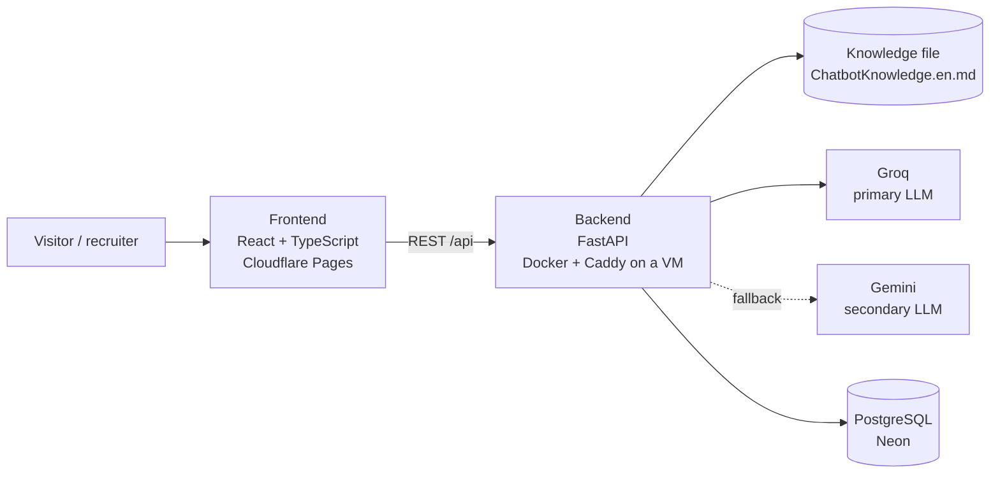

# Architecture



| Part | Responsibility |
|---|---|
| Frontend | Static single-page portfolio (ES/EN), CV download and the chat widget. Talks to the backend only through `src/services/api.ts`. |
| Backend | Validates chat requests, builds the system prompt from the knowledge file, calls the LLM provider with failover, enforces rate limits and stores anonymous chat logs. |
| Knowledge file | Single source of truth about Johan for the assistant. Versioned with the code. |
| PostgreSQL | Anonymous log of questions asked to the assistant (no personal data), used to improve the knowledge file. |

## Chat contract

`POST /api/chat`, implemented in `backend/app/api/routes/chat.py` and consumed by `frontend/src/services/api.ts`. How a question travels, and every failure mode, is in [`chat-flow.md`](chat-flow.md).

```jsonc
// POST /api/chat
{ "message": "string, 1 to 1000 characters",
  "locale": "es" | "en",                       // language of the site UI; the answer follows the question
  "history": [{ "role": "user" | "assistant", "content": "string" }],   // at most 6 earlier messages
  "quick_question_id": "projects" | "stack" | "production" | "availability" | "challenge" | "ai" }  // optional

// 200 (also for refusals)
{ "answer": "plain text",
  "refused": false,                            // true: off topic or an attack, `answer` is a fixed text
  "section": "projects" | "experience" | "about" | "skills" | "education" | "contact" | null,
  "message_id": "uuid",
  "request_id": "string" }

// Every error has the same body; clients branch on `code`, never on `message`
{ "error": { "code": "rate_limited", "message": "text in the visitor's language",
             "request_id": "string", "details": null } }
```

| Status | `code` | Meaning |
|---|---|---|
| 422 | `invalid_request` | Body not valid (empty, over 1000 characters, unknown field, more than 6 history messages) |
| 429 | `rate_limited` | Too many requests; `Retry-After` says when to try again |
| 502 | `invalid_model_output` | The model answered twice without a usable answer |
| 503 | `assistant_paused` | Switched off, or today's model budget is spent |
| 503 | `assistant_unavailable` | No model could answer in time |

When `section` is present, the UI links to that part of the page under the answer ("Ver en: Proyectos"). A quick-question id is answered from the knowledge file without calling a model.

## Frontend build

`npm run build` type-checks, builds the client, builds a server bundle of the app and prerenders `/es/` and `/en/` into static HTML, so the content is in the HTML itself (SEO, link previews, first paint) and React hydrates it. Set `VITE_SITE_URL` to enable canonical/hreflang tags, absolute Open Graph URLs and `sitemap.xml`.

## Repository layout

```
portfolio/
├── frontend/              React + Vite + TypeScript + Tailwind
│   ├── public/cv/         CV in PDF
│   └── src/
│       ├── app/           App shell and layout composition
│       ├── sections/      Page sections: Hero, About, Experience, Projects, Skills, Contact
│       ├── components/    Reusable UI (ui/) and layout pieces (layout/)
│       ├── features/chat/ Chat widget: components, hooks, API calls and types
│       ├── hooks/         Shared hooks
│       ├── i18n/          Spanish and English UI strings
│       ├── data/          Portfolio content (profile, projects, skills)
│       ├── services/      HTTP client for the backend
│       ├── styles/        Tailwind entry point and theme
│       └── test/          Test setup
├── backend/               FastAPI
│   ├── app/
│   │   ├── main.py        App factory: CORS and routers only
│   │   ├── core/          Settings and cross-cutting helpers
│   │   ├── api/routes/    Thin HTTP routers
│   │   ├── schemas/       Pydantic request/response models
│   │   ├── services/      Business logic (chat, knowledge loading)
│   │   │   └── llm/       Groq and Gemini clients behind one interface
│   │   ├── db/            Engine and sessions
│   │   └── models/        ORM models
│   ├── knowledge/         Assistant knowledge file
│   └── tests/             pytest
├── deploy/                Caddyfile for the backend VM
├── docs/                  Architecture, decisions and screenshots
└── .github/               CI and Dependabot
```
