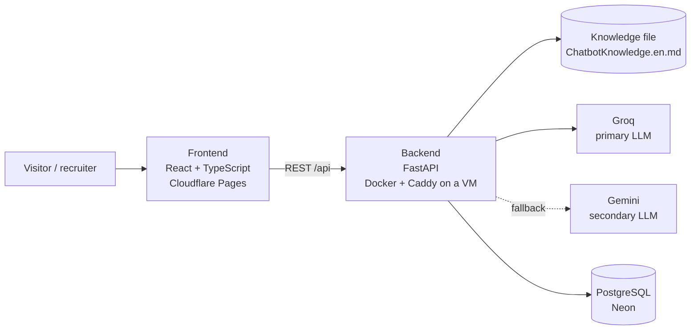

# Architecture



| Part | Responsibility |
|---|---|
| Frontend | Static single-page portfolio (ES/EN), CV download and the chat widget. Talks to the backend only through `src/services/api.ts`. |
| Backend | Validates chat requests, builds the system prompt from the knowledge file, calls the LLM provider with failover, enforces rate limits and stores anonymous chat logs. |
| Knowledge file | Single source of truth about Johan for the assistant. Versioned with the code. |
| PostgreSQL | Anonymous log of questions asked to the assistant (no personal data), used to improve the knowledge file. |

## Repository layout

```
portfolio/
├── frontend/              React + Vite + TypeScript + Tailwind
│   ├── public/cv/         CV in PDF
│   └── src/
│       ├── app/           App shell and layout composition
│       ├── sections/      Page sections: Hero, About, Experience, Projects, Skills, Contact
│       ├── components/    Reusable UI (ui/) and layout pieces (layout/)
│       ├── features/chat/ Chat widget: components, hooks, API calls and types
│       ├── hooks/         Shared hooks
│       ├── i18n/          Spanish and English UI strings
│       ├── data/          Portfolio content (profile, projects, skills)
│       ├── services/      HTTP client for the backend
│       ├── styles/        Tailwind entry point and theme
│       └── test/          Test setup
├── backend/               FastAPI
│   ├── app/
│   │   ├── main.py        App factory: CORS and routers only
│   │   ├── core/          Settings and cross-cutting helpers
│   │   ├── api/routes/    Thin HTTP routers
│   │   ├── schemas/       Pydantic request/response models
│   │   ├── services/      Business logic (chat, knowledge loading)
│   │   │   └── llm/       Groq and Gemini clients behind one interface
│   │   ├── db/            Engine and sessions
│   │   └── models/        ORM models
│   ├── knowledge/         Assistant knowledge file
│   └── tests/             pytest
├── deploy/                Caddyfile for the backend VM
├── docs/                  Architecture, decisions and screenshots
└── .github/               CI and Dependabot
```
