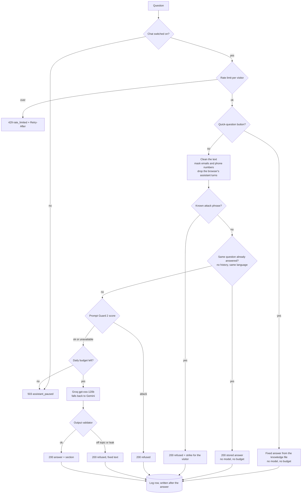

# How the chat works

`POST /api/chat` answers recruiters' questions about Johan, and nothing else. This page explains the path of one question, what happens when something fails, and what to watch when it runs. The rules behind it are numbered in the backend brief (`ERR-`, `DATA-`, `PI-` ids appear in code comments).

## Path of one question

A refusal is still HTTP 200 with `refused: true`. The text of a refusal is written by the code, never by the model, and the visitor is never told which rule fired.

## What each layer is for

| Layer | Stops | Where |
|---|---|---|
| Rate limit, strikes, daily budget | Abuse, and burning the free quota. A visitor is an IPv4 address or an IPv6 /56 block: 10 questions a minute and 30 a day | `services/rate_limit.py`, `services/budget.py` |
| Cleaning | Invisible and blank filler characters, look-alike letters, personal data going to a provider | `services/guard.py` |
| Phrase list | Known injection phrases in Spanish and English, encoded blocks, scrambled words, Cyrillic or Greek look-alikes, phrases hidden by spaces or fillers | `services/guard_patterns.py` |
| Answer cache | Calling a model twice for the same question. It keeps only answers the output validator accepted, for questions asked without history, for a day (`ANSWER_CACHE_TTL_SECONDS`) and up to 500 entries. It is checked after the phrase list, so an attack is still refused, and before Prompt Guard, because a stored question already passed it. It lives in the process, so a restart empties it | `services/answer_cache.py` |
| Prompt Guard 2 | Attacks the list does not know. Long messages go in overlapping pieces of 450 characters, and one bad piece blocks | `services/llm/groq_provider.py` |
| Prompt structure | The visitor's text never enters the system message and cannot close a tag. Only the visitor's earlier questions are sent: the browser also sends the assistant's earlier answers, but it could have invented them, so they never reach the model | `services/prompt.py` |
| Output validator | A leaked prompt or key (checked before and after removing markup, ignoring case and spacing for the canary), links to other sites, HTML, off-topic answers | `services/output_validator.py` |

No single layer is enough. The real protection is that the assistant has no tools, no secrets in its prompt and nothing to act on: the worst a successful attack can do is make it say something off topic, and the validator checks for that.

## When something fails

| Failure | What the visitor gets | What is logged |
|---|---|---|
| Invalid request, or a question with no text left after cleaning | 422 `invalid_request` | |
| Too many requests | 429 `rate_limited` + `Retry-After` | |
| Switch off, or budget spent | 503 `assistant_paused` | `budget_used` at 50, 80 and 100 % |
| Attack detected | 200 `refused: true` | `injection_attempt`, then `ip_blocked` after 3 in 10 min |
| Prompt Guard down or slow | The question goes on | `guard_unavailable` |
| Groq 429 | The wait is remembered for everyone, so later visitors do not call Groq during it. Waits for it (up to 5 s with a fallback, 20 s without, as many times as the deadline allows), or goes to Gemini | `provider_failed` with `retry_after`, `provider_queue_wait` |
| Groq daily quota spent | Gemini, and Groq is paused until its reset. A 429 is also read as daily when it asks for more than 2 minutes | `provider_failed`, `provider_paused` |
| Groq 5xx, timeout, request too large | Gemini | `provider_failed` |
| Groq 400, 401, 403 or 404 (our bug, key or model name) | 503, no fallback | ERROR `provider_request_failed` |
| No provider can answer | 503 `assistant_unavailable` + `Retry-After` if known | `fallback_ineligible` when only the country blocked Gemini |
| A rating cannot be stored | 503 `feedback_unavailable`. The chat is not affected | `feedback_failed` |
| 25 s total exceeded | 503 `assistant_unavailable` | ERROR `deadline_exceeded` |
| Invalid or cut-off model output | 502 `invalid_model_output` (one retry first, none if cut off) | `provider_failed` |
| Answer leaks the prompt or a key | 200 refusal | ERROR `prompt_leak_blocked` |
| Database down | Nothing, the answer is already sent | `chat_log_failed`, `chat_log_dropped` |

The visitor's question never appears in a log line, only its length.

Only one call to Groq runs at a time, and the lock is never held while waiting. A refused call (429) does no work, so it is returned to the daily budget.

## The free Groq tier is the bottleneck

Measured on 2026-10-15 with the real prompt (about 5,100 tokens):

- The limit is 8,000 tokens per minute, so **one uncached question fits per minute**. A second one gets a 429 with `retry-after` of 13 to 16 s.
- Groq's prompt cache is best effort and works only some of the time. Cached tokens do not count toward the limit. Measured on 2026-10-20 and 21 with the same prompt: 2 of 14 real calls reported cached tokens, both 2,304 of about 5,200 (the rules and the first sections, in blocks of 256), and the rest reported none, even for identical questions a minute apart. Groq answered from two regions (`dls` and `yul`) in the same hour, which fits a cache kept per node. We cannot steer it: the system message is already byte for byte the same on every call, with the fixed text first. Do not plan the quota around it.
- The daily limit is 200,000 tokens, which is about 39 uncached questions a day at this size. Groq confirmed it on 2026-10-21: `tokens per day (TPD): Limit 200000, Used 195561, Requested 5543. Please try again in 7m56s`. The wait was minutes, not hours, so it looks like a rolling window rather than a reset at midnight. Cached tokens do not count, which is why a long run can fit more questions than that (48 questions on 2026-10-20 fitted), but it cannot be counted on. When it is spent the router moves to Gemini for visitors who may use it, and the evaluation set (`--country CO`) then mixes in Gemini answers: for a run that must measure Groq, use `--country none`.
- A repeated question does not reach Groq at all: the answer cache (`services/answer_cache.py`) serves it from memory, in a few milliseconds, with no tokens and no budget. It only helps with exact repeats of questions asked without history, such as the ones suggested in the chat. Free text rarely repeats, so it is a small saving, not a fix for the quota.
- Quick-question buttons cost nothing: they never reach a model.
- Model calls are counted against `DAILY_LLM_BUDGET` (300), but Groq's own daily limit trips first, so the budget mostly protects the Gemini quota and stops one person from spending everything.

What the code does about it: a visitor who can use Gemini goes to Gemini at once. A visitor who cannot (EU, EEA, UK, Switzerland, or an unknown country) waits for the `retry-after`, up to 20 s. Beyond that they get a 503 with the contact email.

If this turns out to be too tight, the options are (any can be combined): shorten the knowledge so two questions fit in a minute, put the API behind Cloudflare so the country is known and Gemini can serve everyone outside the excluded regions, move Groq to a paid tier, or pay for Gemini and drop the regional rule. Each one is a decision for Johan; see `docs/decisions.md`.

## Where to look when it misbehaves

All of these are fields in the JSON logs on stdout.

| Symptom | Search for |
|---|---|
| "Always unavailable" | `provider_failed` and `fallback_ineligible` |
| Slow answers | `chat_completed` with a high `latency_ms`, and `cache_cold: true` |
| Is the answer cache working? | `chat_completed` with `status: answered_cached` (no `prompt_tokens`, `latency_ms` near 0) |
| Refusing normal questions | `chat_completed` with `status` `refused_off_topic` or `refused_injection` |
| Paused for the day | `budget_used` |
| One office blocked | `ip_blocked` (restart the process to clear it) |
| Nothing in the database | `chat_log_failed`, `chat_log_dropped` (logged once a minute) |
| A provider cut off for everyone | `provider_paused` (with the reason and the seconds) |
| Visitors queueing for Groq | `provider_queue_wait` |
| Ratings are lost | `feedback_failed` (database), `feedback_recorded` with `duplicate` (a repeated rating) |
| Old rows are not deleted | `chat_log_purged` (once a day) and `chat_log_purge_failed`; see the retention job in the README |

On Windows, start uvicorn with `--reload` while developing, or the log writes fail with `psycopg_needs_selector_event_loop`. Linux is not affected.
