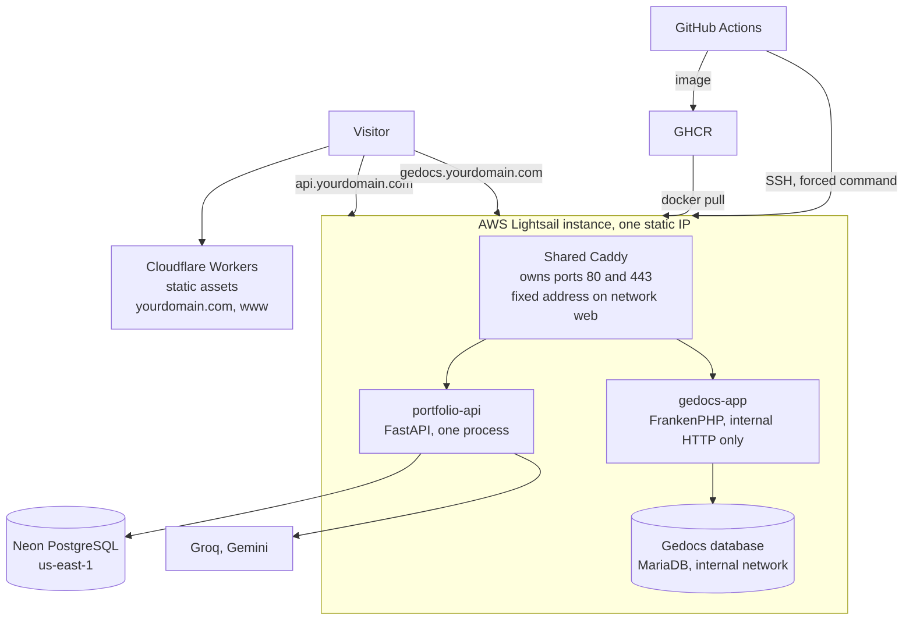

# Deployment runbook

How the portfolio runs in production, how to set it up the first time, how a change reaches it and what to do when it misbehaves. Names that depend on you appear as placeholders: `yourdomain.com`, `<your-github-user>`, `<static-ip>`, `<neon-direct-host>`, `<password>`. Real values live in the Cloudflare and GitHub settings and in the `.env` files on the server, never in the repository.

## What runs where



| Piece | Where | Built and published by |
|---|---|---|
| Frontend | Cloudflare Workers, static assets only (no script) | Cloudflare Workers Builds, on every push to `main` (`frontend/wrangler.jsonc`) |
| API | Docker container on the Lightsail instance, behind the shared Caddy | GitHub Actions: tests, image to GHCR, then an SSH deploy (`.github/workflows/deploy-api.yml`) |
| Shared Caddy | Same instance, `deploy/proxy/` | Pulled with the repository by `deploy/scripts/deploy.sh` |
| Database | Neon, AWS US East (N. Virginia), same region as the instance | Created by hand; migrations run from a developer machine |
| Gedocs demo | Same instance, in its own repository | Its own CI; it joins the shared network with `docker-compose.proxy.yml` |

Why it is built this way: decisions 5, 6 and 20 in [`decisions.md`](decisions.md).

Production is the `main` branch. Work is merged into `develop` through pull requests, and `develop` is merged into `main` when you decide to publish.

## Domains and DNS

| Name | Record | Mode | Serves |
|---|---|---|---|
| `yourdomain.com` and `www.yourdomain.com` | Created by Cloudflare when you add the custom domain to the Worker | Proxied (orange) | The frontend. `www` redirects to the apex |
| `api.yourdomain.com` | `A` to `<static-ip>` | **DNS only (grey)** | The API, through the shared Caddy |
| `gedocs.yourdomain.com` | `A` to `<static-ip>` | **DNS only (grey)** | The Gedocs demo, through the shared Caddy |

The two server names stay grey on purpose. With the orange cloud, Caddy would see Cloudflare's addresses instead of the visitor's, and the per-visitor rate limit would stop working unless Caddy were set up to trust only Cloudflare's published ranges. Do not turn it on without doing that first. The side effect of staying grey is that no country header reaches the API, so `TRUST_CLOUDFLARE_HEADERS` is `false` and Gemini is never used: the assistant depends on Groq's quota alone (decision 11).

## Files on the server

The repository is cloned at `~/portfolio`. Three env files live next to the compose files and are ignored by Git (`.env` and `.env.*` are in `.gitignore`; check with `git status`, they must not appear). Create each from its example and set `chmod 600`.

### `deploy/proxy/.env` (from `.env.example`)

| Variable | Use |
|---|---|
| `ACME_EMAIL` | Address Let's Encrypt writes to about expiring certificates |
| `API_DOMAIN` | Host name of the API |
| `GEDOCS_DOMAIN` | Host name of the Gedocs demo |

### `deploy/api/.env` (from `.env.example`)

Every setting of the API, explained line by line in the example file and in the README. The ones you must set:

| Variable | Use |
|---|---|
| `API_IMAGE` | Image to run: `ghcr.io/<your-github-user>/portfolio-api:latest`. Set it to a `sha-<commit>` tag to go back (see Rollback) |
| `ENVIRONMENT` | `production`: turns off `/docs` and `/openapi.json`, and refuses a `CORS_ORIGINS` that is not explicit https |
| `CORS_ORIGINS` | JSON list with `https://yourdomain.com` and `https://www.yourdomain.com` |
| `SITE_URL` | `https://yourdomain.com`, so answers may link to the site |
| `DATABASE_URL` | Neon, role `portfolio_app` (`SELECT` and `INSERT` only), direct host (no `-pooler`), `sslmode=require` |
| `GROQ_API_KEY`, `GROQ_MODEL`, `GUARD_MODEL`, `CANARY_TOKEN` | Required: the app does not start without them |
| `GEMINI_API_KEY`, `GEMINI_MODEL` | Optional fallback. Unused in production while the API host is DNS only |

It has **no** `MIGRATION_DATABASE_URL` and no `RETENTION_DATABASE_URL`: the owner URL never lives on the server, and the retention URL has its own file. The compose file sets `FORWARDED_ALLOW_IPS` and `STATE_FILE` itself.

The daily model budget is `DAILY_TOKEN_BUDGET` (tokens, default 150000). It replaces `DAILY_LLM_BUDGET`, which counted calls: if the old line is still in `deploy/api/.env`, it is ignored, so change it to `DAILY_TOKEN_BUDGET=150000` at your convenience. The per-visitor allowance for the model is `MODEL_CALLS_PER_VISITOR_HOUR` (3) and `MODEL_CALLS_PER_VISITOR_DAY` (6).

### `deploy/api/.env.retention` (from `.env.retention.example`)

| Variable | Use |
|---|---|
| `RETENTION_DATABASE_URL` | Neon, role `portfolio_retention` (`SELECT` and `DELETE` only), direct host, `sslmode=require` |
| `CHAT_LOG_RETENTION_DAYS` | Rows older than this are deleted (default 90) |

Only the `retention` service reads it, so the running API cannot delete anything.

## First-time setup

### Recommended order

This is the order used in the first production deploy. It is not grouped by provider on purpose: the frontend is published only after the server works, because connecting the repository to Cloudflare makes every push to `main` public, and the site would otherwise go live with a chat that does not answer yet.

| Step | What | Why it goes there |
|---|---|---|
| Before | Preliminary checks (below) | Everything the later steps pull must already exist |
| 1 | Neon | Done once; the API needs its URL |
| 2 | GitHub: security, deploy key, environment | The server must trust a key that already exists |
| 3 | Cloudflare: SSL mode and DNS records | The certificates in step 7 need the records to resolve |
| 4 | Server preparation | Nothing is interrupted yet |
| 5 | Forced command for GitHub Actions | Needs the key from step 2 |
| 6 | Start the API | Needs the image, the env files and the `web` network |
| 7 | Switch Gedocs and start the proxy (cutover) | The only step that interrupts the demo |
| 8 | Publish the frontend (Cloudflare Workers) | After the API answers over HTTPS |
| 9 | First automatic deploy | Last, when everything above works |

Steps marked **(cutover)** interrupt the Gedocs demo for one to three minutes: do them at night.

### Preliminary checks

Before step 1, confirm that:

- The deployment files are in `main` (`deploy/`, `.github/workflows/deploy-api.yml`, `frontend/wrangler.jsonc`).
- The *Deploy API* run for that push is green, and `portfolio-api` appears under **Packages** with `latest` and a `sha-<commit>` tag, public (step 2.7 explains how).
- `docker-compose.proxy.yml` is in the `main` branch of the Gedocs repository, so the server can pull it in step 7.

### 1. Neon

The database already exists (project in `us-east-1`, database `portfolio`) with the tables, the roles and the migrations applied. To rebuild it from nothing:

1. Create the project in AWS US East (N. Virginia) with a database named `portfolio`.
2. In the SQL editor, paste `backend/sql/schema.sql`, then `backend/sql/roles.sql` and `backend/sql/retention_role.sql`, writing a long random password where each file says so (the editor does not accept psql variables).
3. Create the roles with `CREATE ROLE`, as those files do, never from the console: roles made in the console join `neon_superuser` and could read and write everything. Check them with the query at the top of each file; `is_neon_superuser` must be `false`.
4. From your machine, in `backend/`, mark the database as migrated (the SQL files already describe the latest schema) with the owner URL:

```bash
export MIGRATION_DATABASE_URL='postgresql+psycopg://<owner>:<password>@<neon-direct-host>/portfolio?sslmode=require'
alembic stamp head       # PowerShell: $env:MIGRATION_DATABASE_URL = '...'
alembic current          # shows the latest revision followed by (head)
```

Use the direct host, the one without `-pooler`: one process with a small pool does not need the pooler, and migrations must use the direct connection.

### 2. GitHub

1. **Settings > Code security:** turn on Secret scanning and Push protection.
2. Protect `main`: require a pull request and the CI checks, because a merge to `main` reaches production.
3. Create a deploy key on your machine (not your personal key):
   ```bash
   ssh-keygen -t ed25519 -C "github-actions-deploy" -f ~/.ssh/portfolio_deploy -N ""
   ```
4. Pin the server's host key and compare it with the server's own, so the workflow can never talk to an impostor. `ssh-keyscan` does not read `~/.ssh/config`, so it needs the real address, not your SSH alias. To get the address from the alias: `ssh -G <your-ssh-alias> | grep '^hostname'`.
   ```bash
   ssh-keyscan -t ed25519 <static-ip>
   ssh <your-ssh-alias> 'ssh-keygen -lf /etc/ssh/ssh_host_ed25519_key.pub'
   ssh-keygen -lf <(ssh-keyscan -t ed25519 <static-ip> 2>/dev/null)
   ```
   The last two fingerprints must match.
5. **Settings > Environments > New environment**, named `production`. The values must be pasted in exactly this form:
   - `DEPLOY_HOST`: the static IP.
   - `DEPLOY_USER`: `ubuntu`.
   - `DEPLOY_SSH_KEY`: the whole content of `cat ~/.ssh/portfolio_deploy`, with the `BEGIN` and `END` lines and the line breaks. The `.pub` file is not used here: it goes only into `authorized_keys` (step 5).
   - `DEPLOY_KNOWN_HOSTS`: the full line printed by `ssh-keyscan -t ed25519 <static-ip> 2>/dev/null`, that is, the address, `ssh-ed25519` and the key. Without the address it fails. Do not copy the lines that start with `#`.
   - `API_DOMAIN`: `api.yourdomain.com`.
6. Which kind of setting each one is. A job's `if` cannot read the variables of an environment, which is why `DEPLOY_ENABLED` is a repository variable:

   | Name | Kind | Where |
   |---|---|---|
   | `DEPLOY_HOST`, `DEPLOY_USER`, `DEPLOY_SSH_KEY`, `DEPLOY_KNOWN_HOSTS` | Environment secrets | Environment `production` |
   | `API_DOMAIN` | Environment variable | Environment `production` |
   | `DEPLOY_ENABLED` | Repository variable | Settings > Secrets and variables > Actions > Variables (created in step 9, not before) |

7. After the first run of the workflow, open **Packages > portfolio-api > Package settings** and make the image public. If you keep it private, run `docker login ghcr.io` on the server with a token that has only `read:packages`.

### 3. Cloudflare: SSL mode and DNS records

1. **SSL/TLS > Overview:** mode Full (strict).
2. **DNS:** add the `A` record of the API (and check that the one of Gedocs exists), both DNS only, as in the table above. Check with `dig +short api.yourdomain.com` before step 7.

The Worker and the custom domains are not created here: they come in step 8.

### 4. Server preparation (no interruption)

```bash
# Shared network with a fixed subnet (once). The API trusts X-Forwarded-For only from Caddy's address in it.
docker network create --subnet 172.30.0.0/24 web

# Compose 2.24 or later is needed by the Gedocs variant (the !reset tag)
docker compose version

# Clone and create the env files
cd ~
git clone https://github.com/<your-github-user>/developer-portfolio.git portfolio
cp portfolio/deploy/proxy/.env.example portfolio/deploy/proxy/.env
cp portfolio/deploy/api/.env.example portfolio/deploy/api/.env
cp portfolio/deploy/api/.env.retention.example portfolio/deploy/api/.env.retention
```

Edit the three files one at a time, with one `nano` per file (with three files in one `nano` it is easy to miss the other two), then protect them:

```bash
nano portfolio/deploy/proxy/.env
nano portfolio/deploy/api/.env
nano portfolio/deploy/api/.env.retention
chmod 600 portfolio/deploy/proxy/.env portfolio/deploy/api/.env portfolio/deploy/api/.env.retention
git -C portfolio status      # the three files must not appear
```

Log rotation may already be set up from the Gedocs deploy. Look before you write: `cat /etc/docker/daemon.json`. If it is missing, create it. Restarting Docker stops Gedocs for a few seconds, so do it at a quiet hour:

```bash
echo '{"log-driver":"json-file","log-opts":{"max-size":"10m","max-file":"3"}}' | sudo tee /etc/docker/daemon.json
sudo systemctl restart docker
```

Make `deploy/scripts/deploy.sh` executable in Git once (`git update-index --chmod=+x deploy/scripts/deploy.sh`), so the clone keeps the bit.

### 5. Forced command for GitHub Actions

Add the **public** deploy key to `~/.ssh/authorized_keys` of the `ubuntu` user, on one line:

```
command="/home/ubuntu/portfolio/deploy/scripts/deploy.sh",no-port-forwarding,no-agent-forwarding,no-X11-forwarding,no-pty ssh-ed25519 AAAA... github-actions-deploy
```

That key can run only `deploy.sh`: no shell, no other command. Your own key keeps working on its own line. Note that the `docker` group is equivalent to administrator rights: this limits what the key can do, which is why `deploy.sh` and `main` are production code.

**Do not test this key before the cutover (step 7).** Connecting with it runs `deploy.sh`, which tries to start the shared Caddy while Gedocs still holds ports 80 and 443, and fails.

### 6. Start the API (no interruption)

```bash
cd ~/portfolio/deploy/api
docker compose pull
docker compose up -d api
docker compose ps        # api must become "healthy"
docker compose logs api  # no "forwarded_allow_ips_not_set" and no startup error
```

It cannot be reached from outside yet: that is expected.

### 7. Switch Gedocs and start the proxy (cutover)

```bash
# 1. In the Gedocs repository on the server (change and docs: docker-compose.proxy.yml)
cd ~/gedocs-demo
git pull --ff-only
cp .env .env.before-proxy
sed -i 's/^APP_DOMAIN=.*/APP_DOMAIN=:80/' .env
grep -q '^COMPOSE_FILE=' .env || echo 'COMPOSE_FILE=docker-compose.yml:docker-compose.proxy.yml' >> .env
docker compose up -d            # the interruption starts here: Gedocs frees ports 80 and 443
```

Before starting Caddy, check that the switch worked:

```bash
docker compose ps                                    # in ~/gedocs-demo: PORTS of app must show 80/tcp, 443/tcp WITHOUT 0.0.0.0:...->
sudo ss -ltnp | grep -E ':(80|443)\s'                # must print nothing: nobody holds the ports
docker network inspect web                           # must list the Gedocs app and the API
```

Then start the shared Caddy, which obtains the certificates of the API and of Gedocs:

```bash
cd ~/portfolio/deploy/proxy
docker compose up -d
docker compose logs -f caddy    # wait for "certificate obtained" for both names, then Ctrl+C
```

To go back if something fails:

```bash
cd ~/portfolio/deploy/proxy && docker compose down
cd ~/gedocs-demo && cp .env.before-proxy .env && docker compose up -d
```

Gedocs then works as before, with its own Caddy and the certificate it kept.

### 8. Publish the frontend (Cloudflare Workers)

Only now: from the moment the repository is connected, every push to `main` publishes the site.

1. **Workers & Pages > Create application > Import a repository.** Install the GitHub app "Cloudflare Workers and Pages" and give it access **only** to this repository. Do not use "Clone public repository via Git URL".
2. Fill in the form (the names below are the ones used in October 2026; the menus change):
   - Project name: `portfolio-frontend` (the `name` in `wrangler.jsonc`).
   - Production branch: `main`.
   - In **Advanced settings**: **Path** (the root directory) is `frontend`, and the **build variables** are `VITE_API_URL` = `https://api.yourdomain.com` and `VITE_SITE_URL` = `https://yourdomain.com`. Vite embeds them while it builds, and `VITE_API_URL` also goes into the Content-Security-Policy: the build stops without it.
   - Build command: `npm run build`. Deploy command: `npx wrangler deploy`. Leave the API token on automatic.
   - Leave **Enable preview builds** and **Protect with Cloudflare Access** off.
   - Node is 22 (`frontend/.nvmrc`). Build watch path: `frontend/*`, so backend-only changes do not rebuild the site.
3. Open the `portfolio-frontend.<account>.workers.dev` address: the page loads, an unknown path shows the 404 page, and the browser console has no Content-Security-Policy messages. Two messages that are not errors of the site: `net::ERR_BLOCKED_BY_CLIENT` comes from a browser extension (an ad blocker or a shield), and "preloaded but not used" is a performance hint, not a security one.
4. **Settings > Domains & Routes > Add > Custom domain.** For the apex leave **Subdomain** empty ("Leave empty for root domain"); for `www` write `www`. Enable for **Production**. Cloudflare creates the records and certificates. Only an `A`, `AAAA` or `CNAME` record on the apex or on `www` blocks it: delete those first. Leave `MX`, `TXT` and `NS` records alone.
5. **Rules > Redirect Rules**, with the wildcard template from `www` to the apex: Request URL `https://www.yourdomain.com/*`, Target URL `https://yourdomain.com/${1}`, status 301, **Preserve query string**. Also turn on **SSL/TLS > Edge Certificates > Always Use HTTPS**, so `http://www...` ends well too.
6. When the custom domain works, disable the `workers.dev` address, so the site is not published in two places. The chat would not work there anyway (the API only accepts your domain through CORS), and the address shows the name of your Cloudflare account.

Pages is an alternative: it is also free, and needs the build output directory `dist`, the same build variables and the custom domains in its own settings. Cloudflare recommends Workers for new projects.

### 9. First automatic deploy

1. Create the repository variable `DEPLOY_ENABLED` with the value `true` (**Settings > Secrets and variables > Actions > Variables**, the repository tab, not the environment one).
2. Run the workflow *Deploy API* from the Actions tab (*Run workflow*), or merge a change under `backend/` or `deploy/` to `main`.
3. It must finish green, including the smoke test. To confirm that a deploy really happened, and not only that the run is green:
   - The `deploy` job must have a green check, not *skipped*.
   - The step *Run the deploy script on the server* must end with `deploy finished`.
   - On the server, `journalctl -u ssh | grep "Accepted publickey"` must show the connection at that time.
4. A container that keeps its old uptime is not a failure: `docker compose up -d` recreates it only if the image or the configuration changed, so a run on the same commit leaves it untouched (`Container ... Running` in the log).

## Daily operation

- **Change the API:** merge to `main`. The workflow runs ruff, the format check, mypy and pytest, builds the image, publishes `latest` and a `sha-<commit>` tag, and SSHes to the server, where `deploy.sh` pulls the repository and the image and replaces the container. A change under `deploy/proxy/` is applied by the same script with a Caddy reload, with no restart.
- **Change the frontend:** merge to `main`; Cloudflare builds and publishes it. The previous version stays in the Worker's *Deployments* list.
- **Automatic deploy:** every pull request merged to `main` that changes `backend/**`, `deploy/**` or `.github/workflows/deploy-api.yml` deploys the API through the `deploy` job, which runs only while the repository variable `DEPLOY_ENABLED` is `true`. How to confirm it: step 9 of the setup. Dependabot opens its version-update pull requests against `develop`, so a dependency update reaches production only through the usual merge from `develop`; its security updates always target the default branch, so review them before merging.
- **Migrate the database:** by hand, never from the server, with the owner URL in your shell:
  ```bash
  cd backend
  export MIGRATION_DATABASE_URL='postgresql+psycopg://<owner>:<password>@<neon-direct-host>/portfolio?sslmode=require'
  alembic upgrade head --sql      # read the DDL first
  alembic upgrade head
  alembic current
  ```
  Migrate before deploying code that needs the change, and make migrations compatible with the version still running (add before you use, remove after you stop using).
- **Retention cron:** once, on the server, with `crontab -e`. It runs after the Gedocs nightly reset (08:00 UTC):
  ```cron
  15 9 * * *  cd ~/portfolio/deploy/api && docker compose --profile jobs run --rm retention 2>&1 | logger -t portfolio-retention
  ```
  Check the last run with `journalctl -t portfolio-retention -n 20`: it logs `chat_log_purged` with the number of rows, or `chat_log_purge_failed`.
- **Logs:** `docker compose logs -f api` in `deploy/api`. They are JSON, one `request` line per request plus event lines (`chat_completed`, `provider_failed`, `budget_used`), and never contain the visitor's question or address. Other fields to search for are in [`chat-flow.md`](chat-flow.md).
- **Cut a release:** in a branch from `develop`, set the version in `frontend/package.json` (with `npm version X.Y.Z --no-git-tag-version`), `backend/pyproject.toml` and `backend/app/main.py` (a test checks that the last two agree), and move the `[Unreleased]` entries of `CHANGELOG.md` to a new `[X.Y.Z]` section. Merge it to `develop`, then `develop` to `main`. Wait for the deploy to finish and check it, then tag that commit of `main` with an annotated tag (`git tag -a vX.Y.Z -m "vX.Y.Z: ..."` and `git push origin vX.Y.Z`) and publish the release from GitHub with that tag. Pushing a tag deploys nothing: the workflows only run on `main`.
- **State volume:** the answer cache and today's token count live in the `api_state` volume (`/data/state.json` in the container), so a deploy keeps them. See it with `docker compose exec api python -c "import json; print(json.load(open('/data/state.json'))['budget'])"`, which prints the day, the tokens used and the thresholds already warned. The file holds no visitor question and no address. To empty it (for example to give the quota back by hand, or to drop every cached answer), run `docker compose down && docker volume rm api_api_state` in `deploy/api` and start again with `docker compose up -d`; the volume name is the compose project (`api`) plus `api_state`, check it with `docker volume ls`. The cache also empties itself when the knowledge changes. If the API logs `state_save_failed`, the volume is not writable by the app user (uid 10001).
- **Rotate a key:** edit `deploy/api/.env` and run `docker compose up -d api` (the container is recreated and reads it again).

### Rollback

- **API:** the image of a release is the `sha-<commit>` of the commit it was tagged on (`git rev-parse vX.Y.Z^{commit}`). Set `API_IMAGE=ghcr.io/<your-github-user>/portfolio-api:sha-<commit>` in `deploy/api/.env`, then `docker compose up -d api`. While that line is set, the deploy keeps pulling that tag: set it back to `:latest`, or revert the commit on `main`, to move forward again.
- **Frontend:** in the Cloudflare dashboard, open the Worker's *Deployments* and roll back to a previous version, or revert the commit.
- **Database:** `alembic downgrade -1` with the owner URL, only for a migration that has a safe downgrade (`0002` relabels cached answers as quick answers).
- **Stop the chat without a deploy:** `CHAT_ENABLED=false` in `deploy/api/.env` and `docker compose up -d api`. The assistant answers `503 assistant_paused` and the frontend shows its unavailable state.

## Memory budget

The instance has 2 GB (about 1.86 GiB usable) plus 2 GB of swap. Every container has a limit, so one cannot take the others down.

| Service | Typical | Limit |
|---|---|---|
| System | about 300 MiB | |
| Gedocs (`app`, `scheduler`, `db`) | about 250 MiB, up to 700 MiB during `demo:reset` | |
| API | 80 to 200 MiB | 384M |
| Retention job (runs for seconds) | under 100 MiB | 256M |
| Caddy | 30 to 50 MiB | 128M |

The expected peak is about 1.2 GiB. After a deploy, `docker stats --no-stream` and `free -h` should show the containers well under 900 MiB at rest.

The API must stay one process (never `--workers 2`): the per-visitor limits live in memory and the state file has a single writer, so a second process would split the first and overwrite the second.

## Verification after the first deploy

| Check | Command or action | Expected |
|---|---|---|
| Frontend | Open `https://yourdomain.com` and `https://www.yourdomain.com` | Loads; `www` redirects to the apex |
| Unknown path | `curl -i https://yourdomain.com/no-such-page` | `404` with the 404 page |
| Frontend headers | `curl -sI https://yourdomain.com/es/` | `content-security-policy`, `x-frame-options: DENY`, `strict-transport-security` |
| API health | `curl -i https://api.yourdomain.com/health` | `200`, no `Server` header, with `Strict-Transport-Security` |
| API docs closed | `curl -i https://api.yourdomain.com/docs` | `404` (also `/openapi.json`) |
| CORS allowed | `curl -i -X OPTIONS https://api.yourdomain.com/api/chat -H "Origin: https://yourdomain.com" -H "Access-Control-Request-Method: POST"` | Includes `access-control-allow-origin: https://yourdomain.com` |
| CORS refused | The same command with `-H "Origin: https://evil.example"` | No `access-control-allow-origin` |
| Real visitor address | Send 12 quick questions in a minute from your machine (below), then one from a phone on mobile data | The 11th and 12th get `429`; the phone gets `200` |
| Assistant | One real question from the portfolio | Answers (it spends quota: once or twice is enough) |
| Gedocs | Open `https://gedocs.yourdomain.com` and sign in with a role | Works as before and keeps the session |
| Gedocs uploads | Open an uploaded PDF and look at its headers | Still has the sandbox `Content-Security-Policy` |
| Memory | `docker stats --no-stream` and `free -h` | Containers under about 900 MiB in total at rest |
| `www` redirect | `curl -sI https://www.yourdomain.com/es/ \| grep -iE '^(HTTP\|location)'` | `301` and `location: https://yourdomain.com/es/` |
| Deploy | Merge a small change under `backend/` to `main` | The `deploy` job is green (not *skipped*) and ends with `deploy finished`, and the server log shows `Accepted publickey` at that time. The container has a recent uptime only if the image changed |
| Costs | AWS Billing and Cloudflare analytics after a few days | Only Lightsail on AWS; Neon, Cloudflare, GHCR and Actions at zero |

The API never logs the visitor's address, so the address is checked through the rate limit. Quick questions do not call a model, so this spends no quota:

```bash
for i in $(seq 1 12); do
  curl -s -o /dev/null -w "%{http_code} " -X POST https://api.yourdomain.com/api/chat \
    -H "Content-Type: application/json" -H "Origin: https://yourdomain.com" \
    -d '{"message":"What stack does Johan use?","locale":"en","quick_question_id":"stack"}'
done; echo
```

If the phone also gets `429`, uvicorn is seeing Caddy's address instead of the visitor's: check `FORWARDED_ALLOW_IPS` and that the Caddy container has the fixed address (`docker network inspect web`).

## Troubleshooting

| Symptom | Likely cause and fix |
|---|---|
| `502` from Caddy | The `api` container is not running, not healthy, or not on the `web` network. `docker compose ps` in `deploy/api`; `docker network inspect web` must list it |
| The chat shows "assistant unavailable" | Open the browser network tab: a CORS error means `CORS_ORIGINS` in `deploy/api/.env` does not list the exact origin (scheme and host, no trailing slash); `503 assistant_paused` means the kill switch or the daily budget; `503 assistant_unavailable` means no model answered (see Groq below) |
| The API container exits with "Read-only file system" | The container runs with `read_only: true` and only `/tmp` writable, because the app writes nothing to disk. If a library needs another path, add a `tmpfs` for exactly that path in `deploy/api/docker-compose.yml`; do not remove `read_only` without writing down why |
| The API container restarts at start | The log says which of `GROQ_API_KEY`, `GROQ_MODEL`, `GUARD_MODEL` or `CANARY_TOKEN` is missing, or that `CORS_ORIGINS` is not explicit https (production) |
| Groq answers `429` or the assistant pauses | Groq's free tier allows about 8,000 tokens a minute and 200,000 a day. Gemini cannot help while `TRUST_CLOUDFLARE_HEADERS` is `false`. Wait for the window, or see the options in `chat-flow.md` |
| Certificate errors, or the API only works over `http://` | DNS does not point to the static IP yet, or ports 80 and 443 are closed in the Lightsail firewall. `docker compose logs caddy` in `deploy/proxy` |
| Cloudflare 525, 526 or a redirect loop on `api` or `gedocs` | The orange cloud is on for a server name. Set it to DNS only |
| The first chat after a quiet period is not stored | Neon suspends its compute when idle and takes several seconds to wake. The answer is not delayed (the row is written afterwards); the first row may be dropped after the 10 s connection timeout. Not an error |
| `chat_log_failed` in the logs | The database is unreachable or `DATABASE_URL` is wrong (role, host or `sslmode=require`). The chat keeps working without the log |
| `forwarded_allow_ips_not_set` at start | The `FORWARDED_ALLOW_IPS` environment variable is missing in the compose file: every visitor would share one rate limit |
| `denied` or `unauthorized` when pulling the image | The GHCR package is private: make it public, or `docker login ghcr.io` with a token that has `read:packages` |
| Out of memory, containers killed | `docker stats --no-stream`, `free -h`, `dmesg \| grep -i oom`. Usually Gedocs during `demo:reset`: check the limits above and the swap |
| The deploy workflow stops at the SSH step | The server key changed (`DEPLOY_KNOWN_HOSTS`), the forced command path is wrong, or `deploy.sh` is not executable |
| The build on Cloudflare fails with "VITE_API_URL is not set" | Add the build variable in the Worker's settings |
| A blocked script or style in the browser console | A Content-Security-Policy message after changing the HTML: rebuild, so `scripts/security-headers.mjs` recomputes the hashes; check with `npx wrangler dev` |
| `net::ERR_BLOCKED_BY_CLIENT` in the browser console | A browser extension (an ad blocker, a shield) blocked a request. It is not the site: try a private window without extensions |
| "preloaded but not used" in the browser console | A performance hint about the font preload, not a security problem. The site works |
| The `deploy` job is *skipped* in a green run | `DEPLOY_ENABLED` does not exist as a **repository** variable (it was created in the environment), its value is not `true`, or the run was not on `main` |
| The container keeps its old uptime after a deploy | Normal when the image and the configuration did not change: `docker compose up -d` recreates nothing. Confirm the deploy as in step 9 |
| The Gedocs `scheduler` shows `unhealthy` | It inherits the healthcheck of the Gedocs image although it serves no web, and keeps working. To silence it, disable the healthcheck of that service in the Gedocs compose file |

## Known limits and pending

- One uvicorn process and 2 GB shared with Gedocs (decision 20).
- Without Cloudflare in front of the API, Gemini is not used and the assistant depends on Groq's free quota (decision 11).
- The answer cache and the token budget survive a restart (decision 21), but the per-visitor counters do not: a deploy resets every visitor's allowance. The cache is per process.
- Everything runs from Docker: the compose files and the scripts in `deploy/`. The instance, the static IP and the firewall are created by hand in the Lightsail console. Terraform is not used (an optional improvement).
- Continuous integration is fully working: the `frontend-browser` job (layout checks and Lighthouse), the `deploy-config` job and the automatic deploy on every merge to `main`.
- Not done yet: uptime monitors for `https://api.yourdomain.com/health` and `https://yourdomain.com`.

## Document history

- 2026-10-21: validated against the first production deploy. The setup now follows the order used then (the frontend is published after the cutover). Added the exact formats of the GitHub secrets, the cutover checks, the Cloudflare form and menu names, how to confirm a deploy and several troubleshooting rows.
- 2026-10-26: added the per-visitor model quota, the token budget and the persisted state volume (decision 21): `api_state` volume, `STATE_FILE`, `DAILY_TOKEN_BUDGET`.
- 2026-10-28: v1.1.0. The state volume and the new variables above ship in this release; the image and the compose file were checked on Docker before it (read-only root, volume, clean shutdown, restore).
